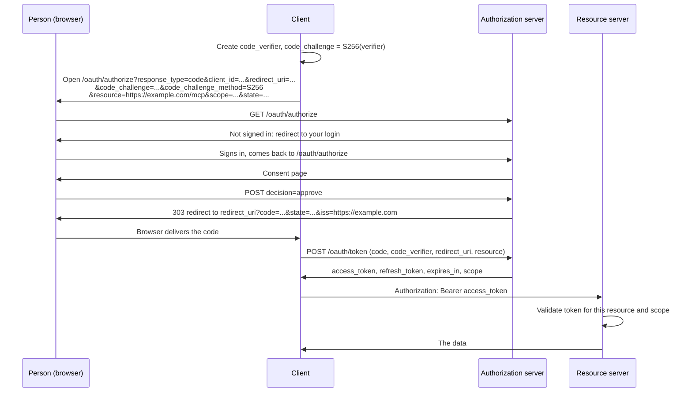

# Concepts

This page explains OAuth in plain words, and the words this library uses. You do not need to know
OAuth to read it.

## The problem OAuth solves

Your application has people. Another program (an AI assistant, a mobile app, a script) wants to act
for one of them: read their posts, create a draft, call your API. The person should not hand their
password to that program. Instead they sign in on your site, say "yes, this program may do these
things", and the program receives a token it can use.

A token is a long random string. Presenting it is proof that the person agreed.

## The players

| Name | Meaning | In your project |
| --- | --- | --- |
| Resource owner | The person who owns the data | A row in your users table |
| Client | The program that wants access | Claude, Cursor, a mobile app, your own script |
| Authorization server | Decides who gets a token. This library | `AuthorizationServer` |
| Resource server | Serves the protected data and checks tokens | Your API or MCP endpoint |

The authorization server and the resource server are often the same application. This library
supports that: you build one `AuthorizationServer` and protect your routes with
`bearerMiddleware()`.

## Resources and scopes

A **resource** is a thing tokens are issued for, for example an MCP endpoint at
`https://example.com/mcp` or an API at `https://example.com/api`. A token is bound to exactly one
resource. A token for the API does not work on the MCP endpoint. This is the `resource` parameter
of RFC 8707.

A **scope** is one permission on a resource, for example `content:read` or `content:publish`. Each
scope has a description that the person reads on the consent page. A scope can imply others: if
`content:publish` implies `content:write`, a token holding `content:publish` also holds
`content:write`. See [configuration](configuration.md).

`offline_access` is a special scope. It is not a permission on a resource. A client adds it to ask
to stay connected after the person leaves (it gets a refresh token). It is never stored as a
resource scope.

## Tokens

All tokens are opaque. They are random strings with a prefix, for example `oauth_at_...`. They
carry no data. Only their SHA-256 hash is stored, so a leaked database does not leak working tokens.

| Token | Prefix | What it is for | Default life |
| --- | --- | --- | --- |
| Access token | `<prefix>_at_` | Sent on every call to the resource | 1 hour |
| Refresh token | `<prefix>_rt_` | Gets a new access token without asking the person again | 30 days, renewed at each use |
| Personal token | `<prefix>_pat_` | Created by a person for a script, no client involved | Chosen by the person, up to 90 days |

Because tokens are opaque, a resource server cannot check one by itself. It asks the storage (through
`TokenValidator`), or, when it is another service, it calls the
[introspection endpoint](endpoints.md#post-oauthintrospect). The upside is that revoking a token
works at once.

Other secrets: **authorization codes** (`<prefix>_ac_`, valid 60 seconds, used once) and **client
secrets** (`<prefix>_cs_`).

## Consent

Before a client gets anything the person sees a consent page: "Claude wants to access Example MCP.
It will be able to: Read your posts." The answer is remembered per person, client and resource, so
they are not asked again for the same scopes, as long as the client can prove who it is (a confidential
client, or an https redirect URI). A local tool with a loopback redirect, such as Claude Code, is asked
on every new connection, because any program on the computer could pose as it.

## Families and connections

Every authorization creates a **family**: the first access token, its refresh token, and every pair
issued by rotating that refresh token. All tokens of a family share a `family_id`. Revoking a family
cuts the client off completely.

A **connection** is a live family, as the person sees it on the connections page: "Claude, access to
Example MCP, connected on 3 May, last used yesterday, [Revoke]".

## The authorization code flow with PKCE

This is the flow every interactive client uses. PKCE (S256) is mandatory: the client invents a
secret (the verifier), sends only its hash (the challenge) in the first step and proves it knows the
secret in the last step. A stolen code is useless without the verifier.

Notes:

- `state` comes back unchanged. The client uses it to match the answer to its request.
- `iss` (RFC 9207) names this server in every authorization answer, errors included. A client that
  talks to several servers uses it to detect mix-ups.
- The `resource` parameter says which resource the token is for. When it is missing the default
  resource is used.

## Three ways a client becomes known

The server must know a client before it can redirect anyone to it.

| Kind | How it is created | Best for |
| --- | --- | --- |
| Metadata document (CIMD) | No registration. The `client_id` is an https URL, and the server downloads the client's description from it | Clients run by a known organization, such as claude.ai. Preferred |
| Dynamic (DCR) | The client posts its description to `/oauth/register` | Clients that cannot use a URL as id, such as local tools and desktop apps |
| Registered | You create it yourself with `ClientRegistrar::create()` | Your own scripts and services, and client credentials |

CIMD is preferred because the client id is a URL that belongs to the client's operator. The consent
page names the host of that URL, which the client cannot fake. A dynamically registered client picks
its own name, so the consent page marks it as unverified. See [clients](clients.md).

The server keeps a copy of each metadata document it fetched as a client row, and refreshes it when
it expires. These rows are removed by [pruning](operations.md) when nobody uses them.

## Where to go next

- [Installation](installation.md) to get a server running.
- [Users](users.md) to connect your application's people.
- [Endpoints](endpoints.md) for the HTTP reference.
